<h1 align="center">
  <br>
  aws-emulator-jvm
</h1>

[](https://github.com/achird-labs/aws-emulator-jvm/actions/workflows/ci.yml)
[](https://achird-labs.github.io/aws-emulator-jvm/)

[aws-emulator](https://github.com/aws/aws-emulator) inside the JVM process. A Rust library links DynamoDB, S3 and KMS
behind a byte-level C ABI; a Scala 3 binding loads it with the foreign function API and implements the AWS SDK for
Java's HTTP clients. Tests get the emulator with no Docker, no port and no TLS.

<p align="center">
  
</p>

**[Documentation](https://achird-labs.github.io/aws-emulator-jvm/)**:
[getting started](https://achird-labs.github.io/aws-emulator-jvm/getting-started/),
[guide](https://achird-labs.github.io/aws-emulator-jvm/guide/clients/),
[architecture](https://achird-labs.github.io/aws-emulator-jvm/architecture/),
[decisions](https://achird-labs.github.io/aws-emulator-jvm/decisions/),
[API](https://achird-labs.github.io/aws-emulator-jvm/api/).

```scala
val emulator = EmuCore.open() // loads the emu-core library the jar bundles for this platform
val dynamoDb = DynamoDbAsyncClient
  .builder()
  .httpClient(EmuAsyncHttpClient(emulator))
  .endpointOverride(URI.create("http://emulator.invalid"))
  .region(Region.US_EAST_1)
  .credentialsProvider(StaticCredentialsProvider.create(AwsBasicCredentials.create("test", "test")))
  .build()
```

```sh
cargo test -p emu-core   # the C ABI
sbt test                 # builds emu-core, then tests the binding in a forked JVM
```

One jar, with the native library for Linux x86_64, Linux arm64 and macOS arm64 inside. JDK 22+. Upstream pinned to
one commit. Apache 2.0.
