# Threads and lifetimes

## Inside emu-core

`Emulator::new` does two things, on two kinds of thread:

- It assembles the router on a dedicated thread with a 64 MiB stack. Upstream's generated deserializers are deep
  enough to overflow a default-sized stack while the router is built, and upstream's own binary does the same.
- It starts a multi-threaded tokio runtime whose worker threads, named `emu-worker`, have 16 MiB stacks: upstream's
  figure for the threads that handle requests.

`emu_dispatch` blocks the calling thread on that runtime and runs the request as a spawned task on a worker. The
calling thread only waits, so any number of host threads may dispatch at once; the router is cloned per request and
shares its engine.

## Inside the JVM

`EmuCore.dispatch` is safe to call from many threads. Each call allocates in its own confined arena, so calls share no
native memory with each other.

The blocking client dispatches on the caller's thread. The async client dispatches on its own pool of daemon platform
threads, `emu-http`, because a native call cannot yield: on a virtual thread it would pin the carrier, and on the
caller's thread it would block code that expected a future. See [0004](../decisions/0004-async-threads.md).

## Closing while calls run

Freeing an emulator while a call is inside it would be a use-after-free in native code: a crash, not an exception.
`EmuCore` rules it out with a read-write lock:

- `dispatch` holds the read lock for the whole native call, so calls run side by side.
- `close` takes the write lock. It waits until every running call has returned, frees the emulator once, and marks it
  closed. A second `close` does nothing.
- A call that finds the emulator closed throws `IllegalStateException` without touching native memory. That includes
  a call that arrived while `close` was waiting: the lock queues it behind the waiting `close`.

[0005](../decisions/0005-close-semantics.md) records the choice.

## Owning an emulator

| Object | Owns | Closed by |
|---|---|---|
| `EmuCore` | the native emulator | whoever called `EmuCore.open()` |
| `EmuHttpClient` | nothing | the SDK client that wraps it; a no-op |
| `EmuAsyncHttpClient` | its `emu-http` thread pool | the SDK client that wraps it |

Close SDK clients before the emulator they use. A request sent after the emulator is closed fails with
`IllegalStateException`, which the SDK reports as a client-side failure.
