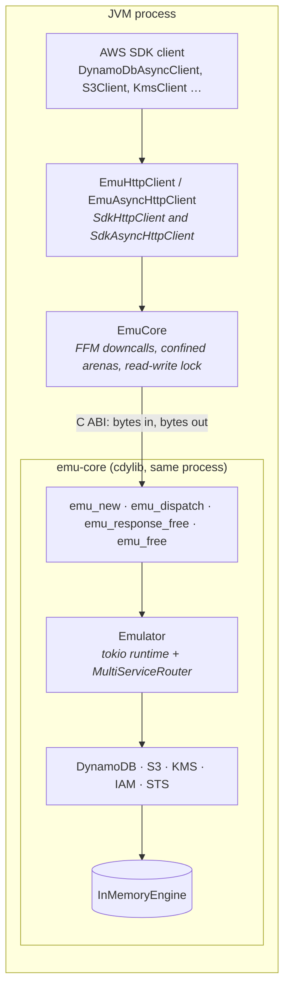

# Architecture

Two layers meet at a C ABI. Below it, `emu-core` is a Rust library that assembles upstream aws-emulator's router and
runs it. Above it, the JVM binding loads that library with the foreign function API and adapts it to the AWS SDK.



## The parts

| Part | Language | Role |
|---|---|---|
| `Emulator` | Rust | one router over one fresh in-memory engine, and the tokio runtime that drives it |
| C ABI | Rust | four `extern "C"` functions and one `#[repr(C)]` struct; whole requests and responses as bytes |
| `EmuCore` | Scala | loads the library, makes the downcalls, owns the emulator's lifetime |
| `EmuHttpClient`, `EmuAsyncHttpClient` | Scala | adapt the SDK's request and response types to `EmuCore.dispatch` |

## One request

```mermaid
sequenceDiagram
  participant S as SDK client
  participant H as EmuHttpClient
  participant C as EmuCore
  participant R as emu-core
  participant E as router
  S->>H: HttpExecuteRequest (signed)
  H->>H: read body; add host header if absent
  H->>C: dispatch(method, path?query, headers, body)
  C->>C: frame headers as name: value lines; refuse CR, LF
  C->>R: emu_dispatch(emulator, method, uri, headers, body, out)
  R->>E: http::Request<Bytes>
  E-->>R: http::Response<Bytes>
  R-->>C: 0, out = EmuResponse { status, headers*, body* }
  C->>C: copy to EmuReply; emu_response_free(out)
  C-->>H: EmuReply(status, headers, body)
  H-->>S: SdkHttpResponse + body stream
```

## Read on

- [The C ABI](c-abi.md): the four functions, the response struct, and who frees which buffer.
- [Threads and lifetimes](concurrency.md): what runs where, and why `close` is safe while calls are running.
- [Decision records](../decisions/README.md): why a C ABI, why FFM, why a pinned upstream commit.
