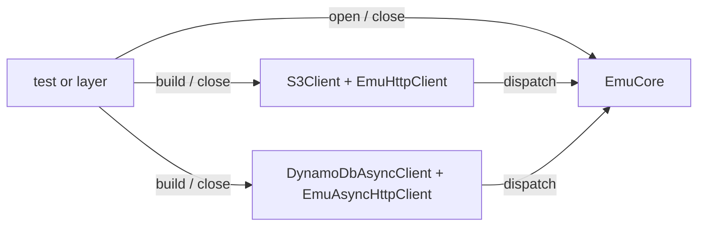

# SDK clients

The binding implements both HTTP client interfaces of the AWS SDK for Java v2. Pass either one to a service client's
builder with `.httpClient(...)`, in place of Apache, Netty or the CRT client.

| Interface | Class | For |
|---|---|---|
| `SdkHttpClient` | `EmuHttpClient(emulator)` | blocking clients: `S3Client`, `DynamoDbClient`, `KmsClient`, … |
| `SdkAsyncHttpClient` | `EmuAsyncHttpClient(emulator)` | async clients: `S3AsyncClient`, `DynamoDbAsyncClient`, `KmsAsyncClient`, … |

Both are thin: they turn the SDK's request into a method, a URI (path and query), header lines and a body, call
`EmuCore.dispatch`, and turn the `EmuReply` back into an SDK response.

## Blocking: `EmuHttpClient`

The call runs on the caller's thread. It reads the request body to the end, dispatches, and wraps the reply body in an
in-memory stream. `close()` does nothing.

## Async: `EmuAsyncHttpClient`

A native call blocks its thread until the router answers. So the async client never makes it on the caller's thread,
and never on a virtual thread, where it would pin the carrier. Each client owns a cached pool of daemon platform threads
named `emu-http`. The call:

1. collects the request body from the SDK's publisher,
2. dispatches on an `emu-http` thread,
3. hands the SDK the response headers, then the body as a single chunk,
4. completes the returned future once the SDK has consumed the body, or cancelled it.

A failure at any step goes to the SDK's response handler and fails the future. `close()` shuts the pool down; calls
already running finish. [0004](../decisions/0004-async-threads.md) records why the pool belongs to the client.

## Who closes what

A client never owns its emulator. Closing a client closes only the client; the emulator stays open for other clients
built on it. Whoever called `EmuCore.open()` closes it, after the clients built on it.

Many clients, sync and async, may share one emulator, and share its state: a table one client creates is visible to
the others.

## What is not supported

- **Streaming.** Request and response bodies are buffered whole in memory, and copied on each side of the C ABI.
  Large S3 objects cost their size in heap several times over while they cross.
- **Abort.** `abort()` on a blocking request does nothing: a native call cannot be interrupted once it has started.
- **Network timeouts.** Nothing goes over a network, so the SDK's connection and socket timeouts never fire.
