# aws-emulator-jvm

aws-emulator-jvm runs [aws-emulator](https://github.com/aws/aws-emulator) **inside the JVM process**. A small Rust
library, `emu-core`, links DynamoDB, S3 and KMS (with the IAM and STS services KMS reads its policies from) behind a
byte-level C ABI. A Scala 3 binding loads it with the Java foreign function API and implements the AWS SDK for Java's
HTTP client interfaces, so an ordinary SDK client talks to the emulator with no container, no port and no TLS.



## Why

A JVM test that wants a broad AWS emulator today runs a Docker image, trusts its self-signed certificate and finds a
free port. Each of those is a moving part on a laptop and in CI. aws-emulator's own embedded mode avoids them, but only
for Rust callers: it hands a Rust SDK an in-process HTTP client.

aws-emulator-jvm gives the JVM the same thing. An SDK client built with `EmuHttpClient` or `EmuAsyncHttpClient` hands
each request to the emulator's router as bytes and gets the response back from the same call.

## What you get

- **DynamoDB, S3 and KMS**, plus IAM and STS, from upstream aws-emulator pinned to one commit. Behaviour is upstream's,
  so a table starts `CREATING`, a failed condition is a `ConditionalCheckFailedException`, and KMS decrypts
  what it encrypted.
- **Both SDK client interfaces**: `SdkHttpClient` for blocking clients and `SdkAsyncHttpClient` for async ones.
- **Isolation by instance.** Every `EmuCore.open()` is a new emulator over a new in-memory engine; two never share
  state, so tests can run side by side.
- **Safe to share across threads**, and safe to close: `close` waits out running calls, and later calls fail instead
  of touching freed memory.
- **Nothing leaves the process.** No socket is bound, and upstream's usage telemetry is never started.

## At a glance

```scala
import awsemulator.{EmuCore, EmuHttpClient}
import java.net.URI
import software.amazon.awssdk.auth.credentials.{AwsBasicCredentials, StaticCredentialsProvider}
import software.amazon.awssdk.regions.Region
import software.amazon.awssdk.services.s3.S3Client

val emulator = EmuCore.open() // the native library named by -Demu.core.library
val s3 = S3Client
  .builder()
  .httpClient(EmuHttpClient(emulator))
  .endpointOverride(URI.create("http://emulator.invalid")) // never resolved: no socket is opened
  .forcePathStyle(true)
  .region(Region.US_EAST_1)
  .credentialsProvider(StaticCredentialsProvider.create(AwsBasicCredentials.create("test", "test")))
  .build()

s3.createBucket(_.bucket("reports"))
```

[Get started](getting-started.md){ .md-button .md-button--primary }
[How it works](architecture/index.md){ .md-button }
